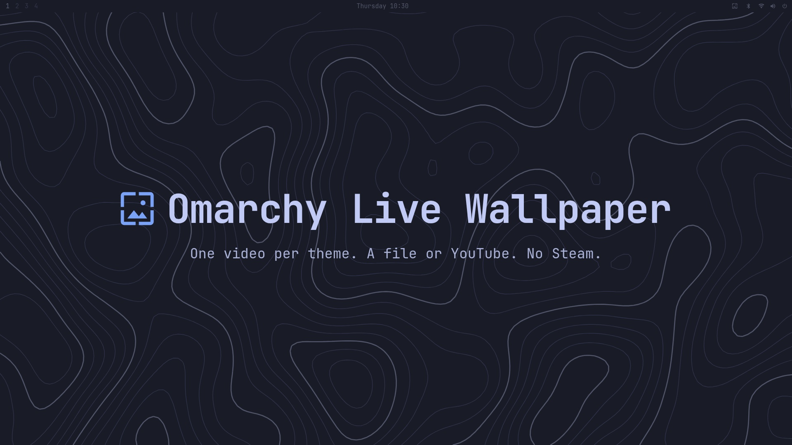

# Omarchy Live Wallpaper

*[Leer en español](README.es.md)*

[](brag-output/brag-en.mp4)

Animated wallpapers for [Omarchy](https://omarchy.org): every theme can have **one video**
(a local file or a YouTube link), and from the bar you choose between the **theme image**
and that video.

- The video loops silently and **pauses whenever a window covers the desktop**, like
  Wallpaper Engine's "pause when another app is maximized". While paused, the GPU sits at
  the same level as with a static wallpaper; playing a 1080p60 video costs roughly 6–16 W
  depending on how many monitors show it (measured on an RX 6800).
- Switch themes and come back: its video returns, or the exact image you had picked.
- The lock screen, `omarchy theme bg next` and the background switcher keep working:
  to Omarchy, the video is just its poster image.

## Install

```bash
omarchy plugin add https://github.com/CristoSolar/omarchy-live-wallpaper --enable
omarchy hook install theme-set ~/.config/omarchy/plugins/io.github.cristosolar.livebg/hooks/theme-set
```

Enabling it adds the 󰸉 button to the right side of the bar; move it with
`omarchy bar move io.github.cristosolar.livebg`. The hook is optional: without it
everything works except restoring a theme's video or image when you return to it.

It replaces the stock background renderer (`omarchy.background`), using Omarchy's own
clone mechanism. To go back: `omarchy plugin disable io.github.cristosolar.livebg`.

Requires `ffmpeg`, `jq` and, for YouTube, `yt-dlp`. The menu UI is in Spanish.

To uninstall: `omarchy plugin remove io.github.cristosolar.livebg` and delete
`~/.config/omarchy/hooks/theme-set.d/theme-set`. Videos stay in `~/.local/share/livebg/`
until you delete them.

## Usage

From the bar: 󰸉 → **Imagen del tema** (theme image) / **Video** → **Archivo…** (file) or
paste a YouTube URL.

From a terminal (`bin/livebg`):

```bash
livebg set ~/Videos/rain.mp4                      # set/replace the current theme's video
livebg set "https://www.youtube.com/watch?v=..."  # ≤1080p, video only, first 5 minutes
livebg video                                      # switch to the theme's video
livebg image                                      # back to the last image you picked
```

Files:
- Video: `~/.local/share/livebg/<theme>/video-<n>.{mp4,webm}` plus a `.jpg` poster.
- What each theme remembers: `~/.local/state/livebg/<theme>/{mode,last-image}`.

## How it works

The system background always points at the poster image. The plugin, a clone of
`omarchy.background`, looks for a sibling `video-<n>.mp4|webm` next to that poster and
plays it on top with QtMultimedia (hardware decoding through FFmpeg). Pausing follows
Hyprland's workspace state, with no polling. User choices arrive through the `background
set` IPC call, while theme switches arrive through `themeTransition`, which is how the
plugin tells "you picked this" apart from "the theme changed".

## Limits

- One decoder per monitor that is showing the video. Sharing one is not possible in pure
  QML: `MediaPlayer.videoOutput` takes a single output, `VideoSink` cannot be created and
  has no `setVideoFrame`, and each monitor is a separate window.
- It does not pause while the screen is locked: the lock state is not available to
  third-party plugins without polling.
- Returning to a theme flickers once: Omarchy sets its default image and the hook
  corrects it half a second later.
- YouTube downloads show MB, not a percentage: with `--download-sections`, yt-dlp does not
  report a total.
- Downloading from YouTube is against its terms of service. If `yt-dlp` breaks, update it.
- `Background.qml` is a copy of the stock one plus the video layer and the menu state; it
  has to be synced if Omarchy changes the original.

## Tests

```bash
./test.sh
```

## License

MIT
